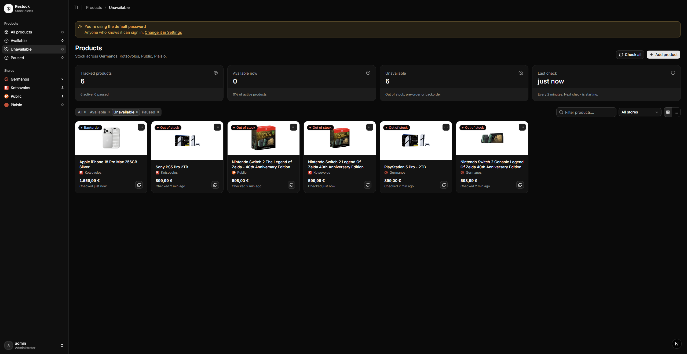

# Restock

Restock keeps an eye on products at Greek online stores and sends you a
Discord message as soon as one comes back in stock.

It works with **Germanos**, **Kotsovolos**, **Plaisio** and **Public**.

> **Made with AI.** Restock's code and documentation were written by Claude,
> Anthropic's AI assistant, following its owner's instructions.



## Run it

You need [Node.js](https://nodejs.org) 20 or newer. In the project folder, run:

```bash
npm install
npm run dev
```

Then open <http://localhost:3000> in your browser.

To keep it running permanently, use `npm run build` once and then `npm start`.

## Quick Setup

### 1. Sign in

Sign in with username **admin** and password **admin**.

Then change the password: click your name at the bottom left, choose
**Settings**, and fill in **Password**. A yellow banner reminds you until you
do.

### 2. Connect Discord

Restock sends its alerts to a Discord channel. For that it needs the
channel's **webhook link**, which starts with
`https://discord.com/api/webhooks/`. If you don't have one, ask whoever runs
your Discord server for it.

1. Click your name at the bottom left and choose **Settings**.
2. In **Discord webhooks**, click **Add webhook**.
3. Type a name you'll recognise (for example "My alerts"), paste the link and
   click **Add webhook**.
4. Click the **⋯** button next to it and choose **Send test**. A test message
   should appear in your Discord channel within a few seconds.

Keep the link private: anyone who has it can post in that channel.

### 3. Add a product

1. On the **Products** page, click **Add product** at the top right.
2. Pick the store.
3. Type the product name and click **Search**, or paste the product's link
   from the store's website.
   For **Public**, searching by name doesn't work: open the product on
   public.gr, copy the link from your browser's address bar and paste it.
4. Click **Select** next to the product you want.
5. If it comes in several colours or bundles, tick the ones you want to watch.
6. Click **Track product**.

Add as many products as you like.

### That's it

Restock now checks every product every 5 minutes, even when the page is
closed, as long as Restock itself is running. When a product comes back in
stock, you get a Discord message with its price and a link to buy it.

## Everyday use

### Products page

- Each product shows its status, its price and when it was last checked.
- **Filter** with the tabs (All, Available, Unavailable, Paused), the store
  menu or the search box. The left sidebar has the same shortcuts.
- **Switch between cards and a list** with the two buttons at the right of the
  filters.
- **Check a product right now** with its circular-arrows button.
- The **⋯** button lets you open the product on the store's website, pause or
  resume checking it, or remove it. *View API response* shows the raw data the
  store sent; you only need it for troubleshooting.

### What the statuses mean

| Status       | Meaning                                   | Counts as available? |
| ------------ | ----------------------------------------- | -------------------- |
| In stock     | You can buy it and it ships now           | Yes                  |
| Low stock    | In stock, but only a few are left         | Yes                  |
| Pre-order    | You can order it before it's released     | No                   |
| Backorder    | You can order it, but it ships later      | No                   |
| Coming soon  | It can't be ordered yet                   | No                   |
| Out of stock | It can't be bought online right now       | No                   |
| Paused       | You stopped checking this product         | –                    |

Products sold only in the store's shops count as out of stock, because you
can't order them online.

You get a "back in stock" message only when a product goes from unavailable to
available. If a check fails, for example because the store's website is down,
Restock keeps the last status it knew and simply tries again at the next
check, so a hiccup never sends you a false alert.

### Settings

Click your name at the bottom left and choose **Settings**.

- **Check interval**: how often products are checked (every 5 minutes by
  default). Shorter means faster alerts but more visits to the stores.
- **Notifications**: whether you get a message when a product comes back in
  stock (on by default) and when it sells out (off by default).
- **Discord webhooks**: add more channels, send a test message, switch one off
  or remove it.
- **Password**: change your password.

You can also sign out from the same menu.

## Your data

Everything Restock knows (your products, settings and webhooks) is saved in the
`data` folder inside the project. To back it up, stop Restock and copy that
folder. To start over from scratch, stop Restock and delete it; you'll sign in
with admin / admin again.

## For developers

Configuration, how each store is checked, adding a new store and the UI
components are described in [DEVELOPMENT.md](DEVELOPMENT.md).
